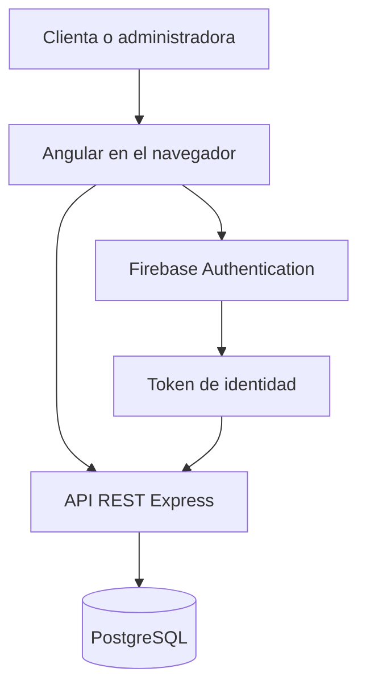

# Arquitectura de LUMA con PostgreSQL

| Capa | Responsabilidad |
|---|---|
| Angular | Catálogo, galería, bolsa, checkout, historial y panel. Conserva la bolsa de la demo en el navegador. |
| Firebase Authentication | Cuentas y tokens. El desarrollo local usa el emulador. |
| API REST | Valida la identidad, consulta el rol, valida entradas y aplica las reglas de compra y administración. |
| PostgreSQL | Productos, fotos, stock por talla, pedidos, partidas, pagos simulados, solicitudes y auditoría. |
| Proxy `/api` | Conecta Angular a Express. La guía separa el inicio local del alojamiento de producción. |

En la confirmación de pedido, la API verifica precio y stock, guarda el folio y registra el movimiento en una transacción. La clave idempotente identifica un intento por cliente y evita duplicados. El catálogo almacena fotos adicionales con posición y texto alternativo. Las operaciones administrativas comprueban el rol en la API.

[OpenAPI](../server/openapi.json) · [Modelo relacional](15_POSTGRES_OPERACION.md) · [Ficha técnica](12_FICHA_TECNICA.md)
