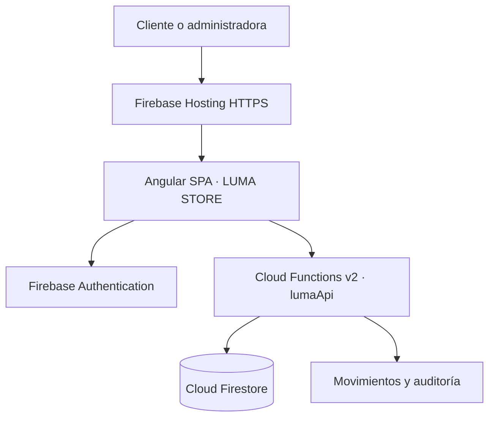

# 05. Arquitectura de la solución

## Diagrama de contexto

## Capas
**Presentación:** Angular 22 con componentes y señales; conserva carrito/favoritos en almacenamiento del navegador y no contiene credenciales de administrador. **Identidad:** Firebase Auth administra contraseñas, sesión y correo de recuperación. **Negocio:** Cloud Functions callable acepta datos tipados por ruta/método, aplica controles de rol y opera transacciones. **Persistencia:** Firestore centraliza catálogo, clientes, pedidos, cupones y registros. **Entrega:** Firebase Hosting publica recursos estáticos vía HTTPS y reescribe URLs desconocidas a `index.html` para SPA.

## Límites del sistema
La demostración utiliza precios, stock, envíos y pagos ficticios. No incorpora pasarela real, CFDI, logística externa ni app móvil independiente. Cloud Functions v2 exige Blaze. El acceso a Firestore desde cliente está denegado por regla general; se accede exclusivamente mediante API callable, incluso para lectura de catálogo.

## Decisiones relevantes
Las órdenes guardan copia de SKU, precio, cantidad y talla, preservando el precio histórico. Un pedido usa llave de idempotencia. El inventario se ajusta de manera transaccional. Se evita exponer `serviceAccount` o variables secretas en el repositorio. El rol admin se asigna únicamente desde consola privilegiada.
