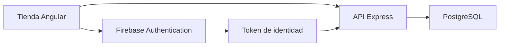

# Ficha técnica de LUMA STORE

| Campo | Especificación de la edición PostgreSQL |
|---|---|
| Propósito | Prototipo académico B2C de ropa y accesorios, con compra y devolución simuladas |
| Frontend | Angular, TypeScript y CSS. Catálogo responsive, galería y navegación con teclado |
| Autenticación | Firebase Authentication. Emulador local para la demostración y tokens de identidad para la API |
| Backend | Node.js 24, Express y rutas REST con OpenAPI |
| Persistencia | PostgreSQL 17 o posterior, migraciones SQL y semilla de 24 productos, 10 categorías y 72 imágenes |
| Puertos locales | Angular 4201, REST 3000, emulador de Auth 9099 e interfaz del emulador 4000 |
| Integridad | Transacciones para pedidos e inventario, permisos por UID y registro de movimientos y auditoría |
| Entorno comprobado | Node.js 24 y PostgreSQL 18.7 en Linux. Instalable desde PowerShell con la guía |
| Despliegue | Demostración local. Para publicar esta edición se necesita alojamiento de Node.js y PostgreSQL con un proxy HTTPS |

[Instalación y operación](../server/README.md) · [OpenAPI](../server/openapi.json) · [Esquema y respaldo](15_POSTGRES_OPERACION.md) · [Pruebas](16_POSTGRES_EVIDENCIAS.md)

## Procedencia de las imágenes de producto

La carpeta [product-gallery](../src/assets/product-gallery) contiene imágenes generadas para esta demostración. Se encargaron seis hojas de catálogo fotográfico. Cada fila corresponde a un producto con una vista frontal, una vista en ángulo y un detalle del acabado. La instrucción visual pidió fondo marfil, iluminación de estudio y el mismo diseño, color y material en las tres tomas, sin personas ni marcas. La asignación final por SKU y sus textos alternativos se encuentran en [gallery-seed.json](../server/gallery-seed.json).
