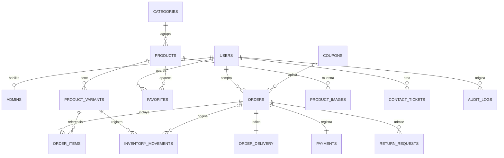

# Modelo relacional y continuidad de LUMA

La migración [001_store.sql](../server/migrations/001_store.sql) declara tipos, claves, nulabilidad, unicidad y restricciones. La semilla reutiliza el catálogo académico original y distribuye las existencias iniciales por talla. Las direcciones, las promociones, los movimientos y las partidas tienen entidades independientes. Las partidas conservan deliberadamente copias de SKU, descripción y precio para el historial del pedido. Los precios de la semilla se manejan en pesos mexicanos enteros.



| Tabla | Campos y controles principales |
|---|---|
| `users`, `admins` | UID externo como PK. La clave foránea en `admins` limita el rol a perfiles existentes. |
| `products`, `categories`, `product_variants` | ID entero, categoría por FK, SKU único, talla única por producto y stock no negativo. |
| `product_images` | FK a producto, posición ordenada, URL única por producto y texto alternativo. |
| `orders`, `order_items` | ID y folio únicos, clave idempotente por cliente, FK a variante, historial de precios y cálculo de total. |
| `order_delivery`, `payments` | Un registro por pedido. Dirección histórica, guía y confirmación de pago simulado. |
| `inventory_movements`, `return_requests` | FK a pedido y tallas, bitácora de salidas y reintegros, folio y estado de solicitud. |
| `favorites`, `coupons`, `contact_tickets`, `audit_logs` | Favoritos por usuario y producto, cupones con vigencia y máximo de usos, atención y registro de acciones administrativas. |

## Consultas de verificación

```sql
SELECT p.sku, v.size, v.stock
FROM products p JOIN product_variants v ON v.product_id = p.id
WHERE p.active
ORDER BY p.sku, v.size;

SELECT o.folio, p.sku, v.size, m.delta, m.reason
FROM inventory_movements m
JOIN orders o ON o.id = m.order_id
JOIN product_variants v ON v.id = m.variant_id
JOIN products p ON p.id = v.product_id
ORDER BY m.id DESC;

SELECT status, count(*) AS pedidos, sum(total) AS total_mxn
FROM orders GROUP BY status ORDER BY status;
```

## Respaldo y restauración

Desde PowerShell, usa una conexión explícita y una **base vacía separada**. Ejecuta `pg_dump`, `createdb`, `pg_restore` y `psql` con una versión de cliente compatible con el servidor. Usa las variables de conexión de tu instalación para evitar escribir contraseñas en los comandos.

```powershell
$env:PGHOST = '127.0.0.1'
$env:PGPORT = '5432'
$env:PGUSER = 'luma'
pg_dump -Fc -d luma_store -f luma_demo.dump
createdb luma_restore
pg_restore --no-owner --exit-on-error -d luma_restore luma_demo.dump
psql -d luma_restore -c "SELECT count(*) AS pedidos FROM orders;"
psql -d luma_restore -c "SELECT count(*) AS movimientos FROM inventory_movements;"
psql -d luma_restore -c "SELECT id,stock FROM product_variants ORDER BY id;"
```

Si el rol de la aplicación carece del permiso `CREATEDB`, crea `luma_restore` como administradora de PostgreSQL y cede su propiedad al rol utilizado para restaurar. Con Docker se pueden usar los mismos programas mediante `docker compose exec postgres`. Guarda el archivo fuera del repositorio y limita su acceso. La copia SQL cubre datos operativos y no incluye las credenciales que gestiona Firebase Authentication.
